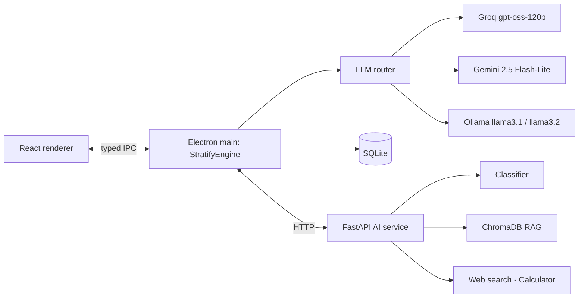

# StratifyAI 🧠

**An AI strategic-thinking assistant that lets you control *how* and *how far* the AI reasons.**

StratifyAI classifies your question with a trained ML model, designs four thinking paths from proven
frameworks (First Principles, 5 Whys, SWOT, Six Thinking Hats…), recommends the best one, and lets you
execute exactly the steps you need: cumulatively or any subset. Every answer becomes a node in a
branching **Thinking Tree**, grounded in your own documents when you want, and every token is measured.

Built with **React + TypeScript + Electron** and a **Python FastAPI** AI service, running entirely on
**free** AI: Groq, Google Gemini and local Ollama models.

[](https://github.com/DevPatel2020/StratifyAi/actions/workflows/ci.yml)


---

## ✨ Features

| | Feature | What makes it interesting |
|---|---|---|
| 🧭 | **Guided thinking paths** | 4 paths per question, each adapted from a framework that matches the question type; run steps cumulatively (▶) or tick any subset (e.g. steps 1 and 3) |
| 🏷️ | **ML question classifier** | TF-IDF + Logistic Regression trained on 200 hand-written + 440 LLM-augmented questions (8 classes); falls back to LLM zero-shot, then keywords |
| 🎯 | **Path recommender** | Hybrid ranking: embedding similarity (MiniLM) + a prior learned from which frameworks you run and like |
| 🌳 | **Thinking Tree** | Tree-of-Thoughts style: branch from any answer, explore alternatives side by side (React Flow) |
| 🧠 | **Conversation memory** | Recent messages on the active branch + an automatically maintained rolling summary |
| 📄 | **Document RAG** | Upload PDF/TXT/MD; chunked, embedded locally, stored in ChromaDB; answers cite `[1]`, `[2]` with file and page |
| 🛠️ | **Agent tools** | Function calling with web search, a safe calculator and document search (ReAct-style loop) |
| 🔍 | **Self-critique** | A reviewer pass scores each answer (1–10) and rewrites it when the score is below 7 |
| 🔀 | **Multi-provider routing** | Groq → Gemini → Ollama fallback on errors or rate limits, with streaming, a Stop button and token/latency logging |
| ⚗️ | **Model Lab** | Same prompt on several models side by side, scored by an LLM judge |
| 📊 | **Analytics & Evaluation** | Real token usage, latency and pipeline-stage costs; classifier metrics, confusion matrix, token-savings and RAG benchmarks |
| 📈 | **CSV insights** | Deterministic column statistics + LLM insights; the dataset stays in context for follow-ups |
| 🎙️ | **Voice input** | Speech-to-text with Groq Whisper |
| ⌨️ | **Polish** | Ctrl+K command palette, Markdown/PDF export, dark/light theme, custom frameworks |

## 🏗️ Architecture



Details: [docs/architecture.md](docs/architecture.md) · Evaluation method: [docs/evaluation.md](docs/evaluation.md) ·
Report outline: [docs/report-outline.md](docs/report-outline.md)

## 🚀 Getting started

**Requirements:** Node.js 20+, Python 3.10+, and at least one of: a free Groq key, a free Gemini key, or
[Ollama](https://ollama.com) running locally.

```bash
git clone https://github.com/DevPatel2020/StratifyAi.git
cd StratifyAi
npm install
```

Create your `.env` from the template and add your own keys (it is git-ignored, never commit it):

```bash
cp .env.example .env
```

| Variable | Default | Notes |
|---|---|---|
| `GROQ_API_KEY` | – | <https://console.groq.com/keys> (free) |
| `GROQ_MODEL` | `openai/gpt-oss-120b` | any chat model your Groq account lists |
| `GEMINI_API_KEY` | – | <https://aistudio.google.com/apikey> (free) |
| `GEMINI_MODEL` | `gemini-2.5-flash-lite` | |
| `OLLAMA_MODEL` / `OLLAMA_FAST_MODEL` | `llama3.1` / `llama3.2` | `ollama pull llama3.1` |
| `EMBEDDINGS` | `chroma` | `chroma` (bundled ONNX MiniLM) or `ollama` (`nomic-embed-text`) |

Set up the Python AI service (creates `ai-service/.venv`, installs packages, trains the classifier):

```bash
npm run ai:setup
```

Run the app (the AI service is started automatically):

```bash
npm run dev
```

The app still works without the Python service: classification falls back to the LLM, and RAG and
tools are disabled.

## 🧪 Testing & evaluation

```bash
npm run typecheck && npm run lint && npm test     # TypeScript: router fallback, pipeline, components
cd ai-service && .venv/Scripts/python -m pytest   # Python: calculator safety, chunking, classifier, API
npm run ai:train                                  # retrain + report classifier metrics
npm run ai:eval                                   # token savings, path quality, latency, RAG benchmark
```

Results appear on the **Evaluation** page. CI runs both test suites on every push.

## 🔐 Security

- Renderer is sandboxed (`contextIsolation`, `sandbox`, no Node integration); only a typed preload API is exposed.
- Strict Content-Security-Policy; external links open in the system browser.
- Model output is rendered as Markdown without raw HTML, so model output cannot inject scripts.
- User input is wrapped in delimiters to reduce prompt injection.
- API keys live only in `.env`; they are never stored in the database or shown in the UI.
- The calculator tool uses an AST whitelist, never `eval`.

## 📦 Build an installer

```bash
npm run dist     # Windows NSIS installer in release/
```

## 🗺️ Project structure

```
src/main/        Electron main: engine, LLM router & providers, pipeline, SQLite, IPC, export
src/preload/     contextBridge API exposed to the renderer
src/renderer/    React app: pages, components, Zustand store
src/shared/      types shared across processes
ai-service/      FastAPI service: classifier, RAG, tools, dataset, training & evaluation scripts
tests/           Vitest unit and component tests
docs/            architecture, evaluation method, report outline
```

## License

MIT © Dev Patel
