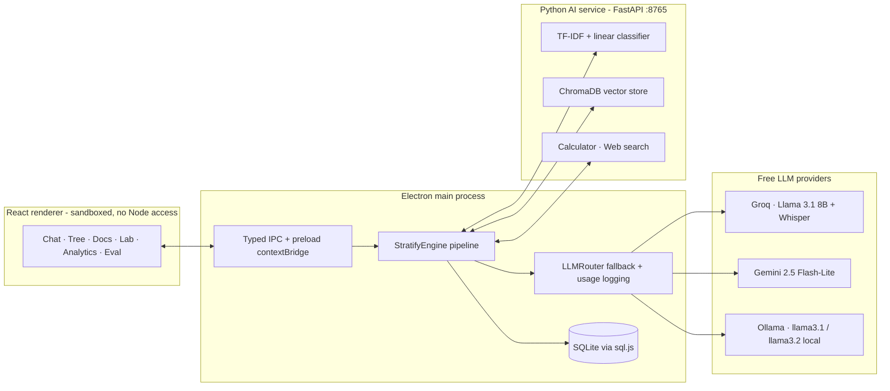

# StratifyAI architecture

StratifyAI is a desktop app made of three cooperating parts:

| Layer | Technology | Responsibility |
|---|---|---|
| Renderer | React 18, TypeScript, Vite, Tailwind, Zustand, React Flow, Recharts | UI: chat, thinking paths, thinking tree, documents, Model Lab, analytics, evaluation, settings |
| Main process | Electron 33, TypeScript, sql.js (SQLite/WASM), OpenAI-compatible SDK, zod | Reasoning pipeline, LLM routing, persistence, export, IPC |
| AI service | Python 3.12, FastAPI, scikit-learn, ChromaDB (ONNX MiniLM embeddings), pypdf, ddgs | Question classifier, document RAG, embedding similarity, agent tools, evaluation results |



## Reasoning pipeline (one question)

```mermaid
sequenceDiagram
  participant U as User
  participant E as Engine
  participant C as Classifier
  participant L as LLM router
  participant R as RAG / tools
  U->>E: question
  E->>C: classify (ML model → LLM zero-shot → keyword heuristic)
  E->>L: generate 4 paths from matching frameworks (JSON mode + zod)
  E->>E: rank paths (0.7 · embedding relevance + 0.3 · learned framework prior)
  U->>E: run path P, steps {1,3}
  E->>R: retrieve document chunks / let the agent call tools (optional)
  E->>L: stream step execution with memory (summary + recent branch)
  E->>L: self-critique → refine if score < 7 (optional)
  E->>L: continuation paths for the next move
  E->>E: store answer as a child node in the thinking tree; update memory summary
```

### Key design decisions

- **One provider class for three vendors.** Groq, Gemini and Ollama all expose OpenAI-compatible
  chat endpoints, so `OpenAICompatProvider` serves all three. `LLMRouter` adds ordered fallback
  (rate limit on Groq → Gemini → local Ollama), streams with fallback only before the first token,
  and logs every call (tokens from the API `usage` field, latency, success) for analytics.
- **Thinking tree (Tree-of-Thoughts).** Messages are stored with `parent_id`; the conversation's
  `head_id` marks the active node. Branching from any node keeps sibling branches intact. Memory
  is built only from the active branch, so parallel lines of reasoning do not leak into each other.
- **Three-tier classifier.** A trained scikit-learn model (milliseconds, offline) → LLM zero-shot →
  keyword heuristic, so the app degrades gracefully when the Python service is not installed.
- **Hybrid path ranker.** Semantic relevance (MiniLM embeddings, cosine) combined with a Laplace-smoothed
  prior learned from which frameworks users run and like for each question type.
- **Structured output.** Paths, critique and judge scores use JSON mode and are validated with zod;
  invalid output is retried once and then replaced by deterministic framework templates.
- **Security.** `contextIsolation: true`, `sandbox: true`, `nodeIntegration: false`, a strict CSP,
  external links opened in the system browser, Markdown rendered without raw HTML (no XSS from model
  output), user text wrapped in delimiters to reduce prompt injection, API keys only in `.env`.
- **sql.js instead of a native SQLite driver.** No native compilation (works on any Node/Electron
  version), standard SQL, persisted atomically to `stratify.sqlite` in the user-data folder.

## Data model (SQLite)

| Table | Purpose |
|---|---|
| `conversations` | title, rolling memory `summary`, `head_id` (active tree node), uploaded CSV `data_context` |
| `messages` | tree nodes: `parent_id`, role, content, `meta` JSON (paths, classification, provider, tokens, citations, tool calls, critique) |
| `usage` | one row per LLM call: provider, model, purpose, tokens, latency, ok/error |
| `feedback` | path runs (framework, question type, steps executed/available) and 👍/👎, the ranker's training signal |
| `templates` | user-defined thinking frameworks |
| `settings` | provider order, models, toggles, theme |
